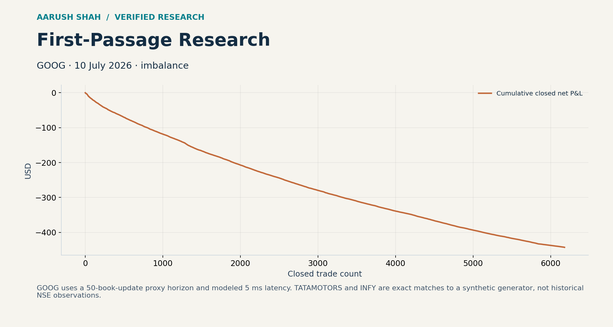

# Causal first-passage research

## Dataset provenance correction — 9 October 2026

The recovered TATAMOTORS and INFY datasets are **synthetic**, not historical NSE data. All stored arrays exactly match `nse_l2_sim.py` with its supplied seeds and parameters in the uploaded L2 toolkit. The generator deliberately embeds an imbalance/flow relationship and corrupt snapshots. All NSE results in this repository must be read as synthetic demonstrations. See the L2 repository’s `verification/synthetic_provenance.json` and audit script for the byte-level array comparison. This supersedes earlier “unknown provenance” wording.


## Project visualization



[Open the interactive explorer](docs/explorer.html) — download and open this self-contained HTML in a browser. GitHub displays the source rather than running it. The explorer reads embedded audited results; full evidence and reproduction commands are below.


**A tested replay engine with explicit label maturity, latency, fees, and data-clock limits.**

This project preserves the corrected backtester after an earlier audit found look-ahead in historical paths. The 48-test suite passes again, including an independent scalar reference on random paths and future-suffix/prefix checks. Legacy profitable tables are not evidence for this replacement.

## Quick start

```bash
python -m pip install -r requirements.txt
python -m unittest -v test_audited_fp
python audit_data.py
python audited_fp_runner.py --kind nse --path data/nse/orderbook_tatamotors_10000snaps.npz --fee-model nse_intraday --q 1 --allow-proxy-clock --out verification/tata-proxy.json
```

The proxy opt-in is deliberate: the supplied files do not establish a full trade clock with exact execution books at 5 ms.

## Signal

Two prespecified variants estimate the next matured first-passage state conditional on (1) imbalance bucket or (2) imbalance bucket and the latest observable resolved state. Labels are released into counts only after the complete 50-count window, so quick hits do not enter the sample sooner than zero outcomes. A label denotes a fee-covering exit opportunity; a delayed actual exit can still lose money.

## Recovered data

- 20 GOOG L1 update sessions, 11 June-10 July 2026: **34,773,653 quote updates**. No trade identifiers; the horizon is quote-update count in proxy mode.
- Tata Motors and INFY: 10,000 L5 snapshots each, with trade-to-snapshot mappings. Intermediate books and intra-snapshot trade order are unavailable.
- Every recovered NPZ was checked for timestamp ordering and basic book validity. Detailed counts and hashes: [data audit](verification/data_audit.json).

Provider/source license was not stored in these NPZs and was not recovered. Preserve them privately; this repository does not invent an exchange provenance or a public redistribution license.

## Fresh proxy results

See `verification/` and the portfolio report for actual rerun results. Tata Motors, one share: 7 closed trades, +INR 5.45 gross, INR 7.65374 fees, -INR 2.20374 net, identical for both signal variants. INFY: zero funded trades under both variants. These are snapshot-based research scenarios, not verified brokerage charges or investable performance.

GOOG, full recovered 10 July 2026 session, one share and $0.0035/share/leg fee scenario: imbalance-only produces 6,179 closed trades and -$442.8925; imbalance+state produces 6,170 and -$444.9095. These use a **50-quote-update proxy horizon**, not 50 trades. All 20 sessions received input-integrity checks; only this full GOOG session was replayed in this review. No parameter selection was performed from these results.

```bash
python audited_fp_runner.py --kind goog --path data/goog/goog_2026-07-10.npz --fee-model per_share --fee-per-share 0.0035 --q 1 --allow-proxy-clock --skip-late-diagnostics --out verification/goog-20260710-proxy.json
```

`--skip-late-diagnostics` is a new optional runner flag that disables the expensive rest-of-session search for later recovery opportunities. It changes no primary labels, orders, or economic results; equality of all predictions and primary Tata summaries was checked against the default run. Late-diagnostic summary zeros in the GOOG output mean **not computed**, not zero late recoveries. The initial diagnostic-enabled GOOG attempt was interrupted and its incomplete outputs are not presented as a completed run.

## Files

- `audited_fp.py`: replacement causal engine.
- `audited_fp_runner.py`: explicit adapters and experiment CLI.
- `test_audited_fp.py`: 48 regression tests.
- `data/`: recovered GOOG and NSE inputs.
- `historical/`: prior engines, result tables, audit packages and HFTBacktest comparison files. Some legacy scripts have missing dependencies; they are preserved for provenance, not presented as working entry points.
- [Prior audit](docs/PRIOR_AUDIT.md): detailed defects, fixes and remaining execution limits.

The >60% accuracy / 0.5 per-trade Sharpe internship claim and earlier May 2021 market-making numbers remain unverified. No source/ledger association was recovered that supports presenting them as reproduced results.
